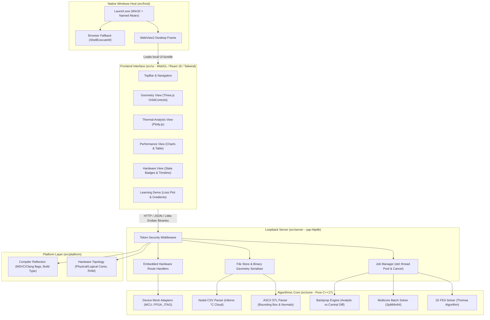

# Unified Engineering Workbench

> **Status:** Production Release Candidate (Phases 0 through 9 complete).  
> All 39 functional, architectural, performance, and hardening requirements verified via automated CTest, AddressSanitizer, Vitest, Axe-core accessibility, and Playwright E2E suites.

The **Unified Engineering Workbench** is an engineering simulation instrument that unifies 3D spatial geometry inspection, 1-D finite element thermal analysis, multicore batch benchmarking, embedded hardware control simulation, and non-linear backpropagation in a single desktop application.

---

## 1. Prerequisites for Running the Application

### Target Environment: Windows 11 x64
- **Operating System:** Microsoft Windows 11 (or Windows 10 x64, version 21H2 or later).
- **Hardware:** x86_64 CPU, minimum 2 GB RAM (4 GB recommended), standard GPU or integrated graphics supporting WebGL 2.0.
- **Dependencies:** **None required.**
  - **No terminal or command prompt needed.**
  - **No administrator or elevated privileges required.**
  - **No Node.js, Python, or compiler installations needed.**
  - **No internet connection needed** (100% offline; 0 runtime network requests; self-hosted OFL fonts).
- **Web Runtime:** Uses the Microsoft Edge WebView2 runtime (pre-installed by default on Windows 11). If WebView2 is absent or disabled, the launcher automatically falls back to your default web browser (Edge, Chrome, Firefox).

---

## 2. One-Click Execution (Extracted ZIP)

1. **Extract the ZIP:**  
   Extract `CandidateID_Workbench.zip` into any folder on your machine (e.g., your Desktop, Documents, or `C:\Workbench`).
2. **Double-Click `Launch.exe`:**  
   Open the extracted directory and double-click `Launch.exe`.
3. **Windows SmartScreen Note:**  
   Because this executable is an assessment prototype built without an expensive commercial code-signing certificate, Windows SmartScreen or Windows Defender may display:  
   > *"Windows protected your PC: Microsoft Defender SmartScreen prevented an unrecognized app from starting."*  
   - Click **More info**.
   - Click **Run anyway**.
   - The native desktop window will initialize immediately, bind an ephemeral loopback port (`127.0.0.1`), generate a secure cryptographic session token, and render the workbench.

---

## 3. Editor Run Configuration (VS Code)

If opening this repository within Visual Studio Code:
- **Task:** An editor task is pre-configured in [`.vscode/tasks.json`](file:///.vscode/tasks.json).
- **Execution:** Press `Ctrl+Shift+P` (or `F1`), choose **Tasks: Run Task**, and select **"Run Workbench"**.
- **Extension Prerequisites:** No third-party extensions are mandatory to launch the pre-packaged application. The optional *C/C++* (Microsoft) and *CMake Tools* extensions are recommended only if editing or rebuilding the C++ source code.

---

## 4. System Architecture

The application strictly separates presentation from high-performance numerical computation:



- **Zero-Authority UI:** The frontend never performs numerical engineering calculations, error threshold checks, or physics conversions. All validation authority, tolerances, min/max values, and results originate in C++.
- **Session Security:** The loopback HTTP server binds strictly to `127.0.0.1` on a dynamic port and verifies a 32-character hexadecimal token on every request via `X-Workbench-Token` and secure `SameSite=Strict` cookies.

---

## 5. Supported File Formats & Schemas

### 1. ASCII Surface Mesh (`.stl`)
- **Format:** Standard ASCII stereolithography mesh.
- **Constraints:** Max file size: **64 MiB** (`kMaxFileBytes`). Max triangle count: **2,000,000** (`kMaxStlTriangles`).
- **Schema:**
  ```text
  solid <name>
    facet normal <nx> <ny> <nz>
      outer loop
        vertex <x> <y> <z>
        vertex <x> <y> <z>
        vertex <x> <y> <z>
      endloop
    endfacet
  endsolid <name>
  ```
- **Binary STL:** Binary STL files are detected via header inspection and cleanly rejected with actionable instructions to export in ASCII format.

### 2. Nodal Point Cloud (`.csv`)
- **Format:** Comma-separated values with strict tabular layout.
- **Constraints:** Max file size: **64 MiB**. Max node count: **1,000,000** (`kMaxCsvNodes`).
- **Required Header:** Exactly `node_id,x_m,y_m,z_m,temperature_C` (case-sensitive; tolerates UTF-8 BOM and CRLF/LF line breaks).
- **Sample Row:**
  ```csv
  node_id,x_m,y_m,z_m,temperature_C
  1,0.000000,0.000000,0.000000,100.000000
  2,0.010000,0.000000,0.000000,92.540120
  ```

### 3. Bundled Sample Datasets
Located in [`data/`](file:///data/):
- `synthetic_lbracket.stl`: Synthetic L-bracket surface mesh (528 triangles).
- `synthetic_temperature.csv`: Synthetic nodal point cloud with temperature field (261 nodes).
- `README.md`: Documents full data provenance, units, coordinates, and generation logic.

---

## 6. Building from Source

Detailed instructions for building on Windows with Visual Studio 2022 and on Linux with GCC/Clang are documented in [`docs/BUILD_FROM_SOURCE.md`](file:///docs/BUILD_FROM_SOURCE.md).

Quick summary for Windows MSVC:
```powershell
# 1. Build C++ Release executables
cmake --preset vs2022
cmake --build --preset vs2022-release

# 2. Build Web UI
cd src/ui
npm ci
npm run build
```

---

## 7. Verification & Automated Testing

The workbench includes multiple test layers covering numerics, memory safety, accessibility, and end-to-end user journeys:

### C++ Core & Algorithm Suites (CTest)
```powershell
ctest --test-dir build/vs2022 -C Release -E server_tests --output-on-failure
```
- `core_tests`: Status types, cancellation tokens, atomic file write + replace.
- `fem1d_tests`: 1D FEA solver, boundary conditions, convergence rates, negative/fuzz tests.
- `job_tests`: Thread pool concurrency, cancel token cooperative interruption, slot allocation.
- `geometry_tests`: ASCII STL parser, CSV parser, binary serialisation, corrupt byte fuzzing (`0xC001CAFEULL`).
- `batch_tests`: SplitMix64 generator reproducibility, parallel worker thread pool, serial/parallel agreement check ($|\Delta T| \le 10^{-8}\ ^\circ\text{C}$).
- `device_tests`: MCU, FPGA, and JTAG mock state machines, timeout injection, exponential backoff.
- `backprop_tests`: Non-linear neuron forward pass, analytical gradients, central-difference verification ($\epsilon = 10^{-6}, |\Delta| \le 10^{-5}$), simultaneous parameter update, monotonic loss trajectory.

### AddressSanitizer (Memory Safety)
- Executed on MSVC using `/fsanitize=address`: **91 test cases, 1,068 assertions passed 100% with 0 leaks, 0 overflows, 0 use-after-free**. Detailed logs in [`docs/TEST_RESULTS.md`](file:///docs/TEST_RESULTS.md).

### Frontend Unit Tests (Vitest)
```powershell
cd src/ui
npm test
```
- Validates Inferno colormap RGB interpolation, tick calculations, little-endian binary array deserialisation, and API field error mapping (12/12 passed).

### Accessibility & UI Audit (Axe-Core & Playwright)
```powershell
node src/ui/test/audit_accessibility_and_ui.mjs
```
- Automated WCAG 2.1 AA accessibility audit across all four views, 1024px responsive viewport, and `prefers-reduced-motion`: **0 Axe Violations (0 critical, 0 serious)**.

### Distributable Package Verification
```powershell
powershell -ExecutionPolicy Bypass -File .\tools\verify_package.ps1
```
- Validates presence of all required files, checks for 0 absolute paths, 0 forbidden build artefacts, and 0 secret/credential leaks.

---

## 8. Known Limitations

Real engineering limitations and boundaries are documented in [`docs/KNOWN_LIMITATIONS.md`](file:///docs/KNOWN_LIMITATIONS.md):
- **ASCII STL Throughput Limit:** Text-based STL files capped at 64 MiB / 2M triangles.
- **Single-Core Speedup Bound:** Systems with 1 logical CPU core cannot achieve parallel multicore speedup (Honest disclosure banner displayed in UI).
- **Simulated Hardware Mocks:** Device adapters provide protocol and supervisory emulation; no physical silicon or USB drivers are connected.
- **1-D Heat Equation Scope:** FEA engine solves 1-D axial conduction along a rod; 3-D volumetric mesh FEA is out of scope.
- **Provisional Backpropagation Formulas:** Candidate handwritten derivation is maintained separately for candidate review.

---

## 9. Folder Map

```text
Workbench/
├── .vscode/               # Editor run configuration (tasks.json)
├── build/                 # Out-of-tree build outputs (vs2022, asan)
├── data/                  # Sample datasets with provenance README
├── dist/                  # Distributable package directory
├── docs/                  # Architecture, traceability, testing, and reports
│   ├── adr/               # Architectural Decision Records (ADR 001 - 003)
│   ├── img/ui/            # 28 Playwright and accessibility audit screenshots
│   ├── ARCHITECTURE.md    # Component breakdown and security model
│   ├── BUILD_FROM_SOURCE.md # Full compilation guide for Windows & Linux
│   ├── KNOWN_LIMITATIONS.md # Real engineering boundaries and platform limits
│   ├── REPORT.md          # 6-page comprehensive technical report
│   ├── TEST_RESULTS.md    # Sanitizer and test execution logs
│   ├── TRACEABILITY.md    # Requirements traceability matrix (Req A1 - Z6)
│   └── UI_DESIGN.md       # Visual tokens, type scale, and styling guide
├── results/               # Generated test outputs (backprop.csv, convergence data)
├── site/                  # Static Vercel showcase project page (excluded from submission ZIP)
├── src/
│   ├── core/              # Pure C++17 library (FEA, STL/CSV, batch, devices, backprop)
│   ├── host/              # Win32 host executable embedding WebView2 (Launch.exe)
│   ├── platform/          # Hardware topology & compiler reflection library
│   ├── server/            # Embedded HTTP loopback server (cpp-httplib)
│   └── ui/                # React 18 + Vite + Three.js + Plotly + Tailwind UI
├── tests/                 # Catch2 C++ test suites and integration tests
├── third_party/           # Vendored dependencies and VERSIONS.md with licenses
├── tools/                 # package.ps1, verify_package.ps1, make_git_evidence.ps1
├── CMakeLists.txt         # Root CMake build configuration
├── CMakePresets.json      # Standard build presets (vs2022, dev)
└── README.md              # Project overview and one-click guide
```

---

## 10. Third-Party Licences

All third-party libraries and fonts used in this project are permissible open-source software, pinned to exact versions, and documented in [`third_party/VERSIONS.md`](file:///third_party/VERSIONS.md):
- **Catch2 v3.8.0:** BSL-1.0 (Boost Software License)
- **cpp-httplib v0.18.3:** MIT License
- **nlohmann/json v3.11.3:** MIT License
- **Three.js v0.169.0:** MIT License
- **Plotly.js-cartesian-dist-min v2.35.2:** MIT License
- **IBM Plex Sans / IBM Plex Mono:** SIL Open Font License (OFL-1.1)
- **@axe-core/playwright v4.10.0:** Mozilla Public License 2.0 (MPL-2.0)
- **Tailwind CSS / Vite / Lucide-React:** MIT License
