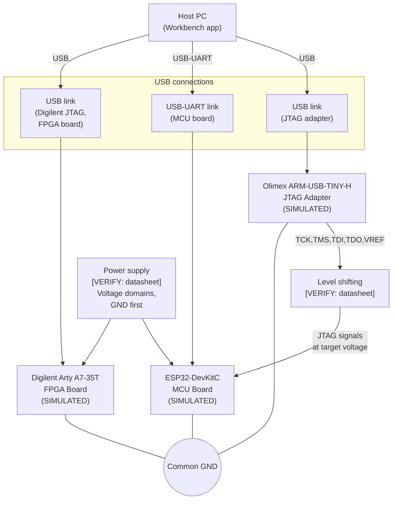

# Embedded System Design

> **IMPORTANT: ALL BEHAVIOUR DESCRIBED IN THIS DOCUMENT IS SIMULATED IN SOFTWARE.**
> No physical hardware is present, connected, or accessed. Every mock adapter carries
> `simulated: true` in every payload. This document is an engineering exercise only.

---

## a. Purpose and scope

This document describes the simulated embedded sub-system of the Unified Engineering Workbench.
The sub-system consists of three mock device adapters representing real boards that a candidate
would connect in a physical implementation:

| Role         | Board chosen                   | Type           |
|--------------|--------------------------------|----------------|
| MCU          | ESP32-DevKitC                  | Microcontroller|
| FPGA         | Digilent Arty A7-35T           | FPGA dev board |
| JTAG adapter | Olimex ARM-USB-TINY-H          | Debug interface|

**Scope:** This document covers the *design intent* and the *simulated software behaviour*.
It does not replace the datasheets for the boards listed above. Every electrical value,
pin number, connector designation and voltage level that depends on a specific board is
written as `[VERIFY: datasheet section]` — the candidate must fill these in from the
manufacturer's documents before any physical connection is made.

---

## b. Block diagram

### SVG version

See `docs/img/embedded_block_diagram.svg` (hand-authored).
The diagram shows: host PC → USB links → JTAG adapter and MCU board (direct USB-UART),
plus a JTAG signal path from the adapter to a target connector on the MCU board,
an alternate JTAG path to the FPGA, shared GND rail, power/voltage-domain box,
and a level-shifting node between the adapter and target.

### Mermaid version

---

## c. Interface and pin-voltage table

> All values in the Voltage domain, Level shifting, Connector, and Notes/Source columns
> that are board-specific are marked `[VERIFY: datasheet section]`. Only generic,
> well-established JTAG facts appear without a placeholder.

| Signal           | Owner/driver         | Direction (→ = to target) | Voltage domain            | Level shifting          | Connector                  | Notes/Source                                               |
|------------------|---------------------|--------------------------|---------------------------|-------------------------|----------------------------|------------------------------------------------------------|
| VCC (adapter)    | Host USB             | → Adapter                | [VERIFY: USB 5V nominal]  | N/A                     | USB Type-A or Mini/Micro    | [VERIFY: Olimex ARM-USB-TINY-H datasheet, power section]   |
| GND              | Common               | Bidirectional / rail      | 0 V                       | None                    | [VERIFY: connector pinout]  | Connect GND first before any signal line                   |
| VCC (MCU)        | [VERIFY: supply]     | → MCU board              | [VERIFY: MCU datasheet]   | N/A                     | [VERIFY: ESP32-DevKitC J1]  | [VERIFY: ESP32-DevKitC datasheet, power section]           |
| VCC (FPGA)       | [VERIFY: supply]     | → FPGA board             | [VERIFY: FPGA datasheet]  | N/A                     | [VERIFY: Arty A7 J8/J7]     | [VERIFY: Arty A7-35T reference manual, power section]      |
| TCK              | JTAG adapter         | → Target                 | VREF (target supplies)    | Yes [VERIFY: adapter HW]| [VERIFY: JTAG header pin]   | JTAG test clock; adapter drives, target receives           |
| TMS              | JTAG adapter         | → Target                 | VREF (target supplies)    | Yes [VERIFY: adapter HW]| [VERIFY: JTAG header pin]   | JTAG test mode select                                      |
| TDI              | JTAG adapter         | → Target                 | VREF (target supplies)    | Yes [VERIFY: adapter HW]| [VERIFY: JTAG header pin]   | JTAG test data in (to target)                              |
| TDO              | Target               | Target →                 | VREF (target supplies)    | Yes [VERIFY: adapter HW]| [VERIFY: JTAG header pin]   | JTAG test data out (from target)                           |
| TRST (optional)  | JTAG adapter         | → Target                 | VREF (target supplies)    | Yes if present          | [VERIFY: JTAG header pin]   | Optional test reset; not all targets expose this           |
| SRST (optional)  | JTAG adapter         | → Target                 | VREF (target supplies)    | Yes if present          | [VERIFY: JTAG header pin]   | Optional system reset                                      |
| VREF             | Target               | Target → Adapter         | Target I/O voltage        | None (sense only)       | [VERIFY: JTAG header pin]   | Adapter senses target voltage to set its output swing      |
| USB D+/D-        | Host PC              | Bidirectional            | USB differential          | N/A (USB phy internal)  | USB connector (adapter)     | Host enumerates adapter as a USB device                    |
| USB D+/D- (MCU)  | Host PC              | Bidirectional            | USB differential          | N/A                     | [VERIFY: ESP32-DevKitC J2]  | USB-UART bridge; [VERIFY: datasheet for bridge IC]         |
| USB D+/D- (FPGA) | Host PC              | Bidirectional            | USB differential          | N/A                     | [VERIFY: Arty A7 J10]       | Digilent onboard JTAG; [VERIFY: Arty reference manual]     |

---

## d. Why the JTAG adapter is a debug interface, not a compute board

A JTAG adapter (the Olimex ARM-USB-TINY-H in this design) is a **debug and programming
interface**, not an interchangeable compute board. The distinction matters because:

1. **Host-side protocol driver, not application CPU.** The adapter translates USB commands
   from the host into JTAG signals (TCK, TMS, TDI, TDO). All computation runs on the host PC;
   the adapter has no general-purpose CPU for user code.

2. **No independent user compute.** Boards such as the ESP32-DevKitC or the Arty A7-35T
   execute user firmware or FPGA logic. The JTAG adapter executes no user logic; it only
   implements the physical JTAG protocol layer.

3. **Signal ownership and voltage reference.** The adapter drives JTAG signals (TCK, TMS,
   TDI) **from the adapter toward the target**. TDO goes from target back to the adapter.
   Critically, **the target board supplies the VREF voltage** that the adapter senses to
   set its output swing. This means the adapter is electrically subordinate to the target
   for voltage level selection — the exact opposite of a compute board relationship.

4. **Connector incompatibility.** The JTAG adapter, the MCU board, and the FPGA board have
   different connectors and voltage domains (`[VERIFY: datasheet section]` for each). The
   assumption that boards can share a connector, voltage rail, or communication protocol
   without per-board verification is incorrect and risks hardware damage.

5. **No user-accessible bus.** Unlike an MCU or FPGA board, the adapter exposes no
   GPIO, SPI, I2C, or UART intended for application code. Its only interface to the host
   is USB, through which it implements OpenOCD-compatible JTAG commands.

---

## e. Safe integration plan and limitations

### Power sequencing

1. Verify all boards are powered off and USB cables are disconnected.
2. Connect all GND lines first (adapter → MCU, adapter → FPGA, MCU → FPGA if shared).
   Common ground before any signal line prevents floating-ground damage.
3. Measure supply voltages on the bench with a multimeter before connecting to boards.
   [VERIFY: acceptable supply tolerance from each board's datasheet.]
4. Power on the FPGA board first (larger current draw; let it stabilise).
5. Power on the MCU board.
6. Connect the JTAG adapter USB last; the host will enumerate it.

### Voltage verification

- Before connecting JTAG signals, measure VREF on the target header with a multimeter.
  [VERIFY: expected VREF from ESP32-DevKitC datasheet; confirm it matches adapter limits.]
- The Olimex ARM-USB-TINY-H senses VREF and adapts its output swing.
  [VERIFY: VREF input range from Olimex ARM-USB-TINY-H datasheet.]
- Never assume 3.3 V or 1.8 V — always measure.

### Current limits and ESD

- Use current-limited lab power supplies where possible.
  [VERIFY: maximum supply current for each board from its datasheet.]
- Observe ESD precautions: wrist strap, anti-static mat, avoid touching signal pins.
- Keep JTAG cable short (< 20 cm recommended) to reduce signal integrity issues.

### Staged bring-up

1. First verify USB enumeration of each device independently (no cross-wiring).
2. Then connect JTAG adapter to MCU only; confirm OpenOCD connection before adding the FPGA.
3. Add FPGA connection only after MCU JTAG is stable.

### Limitations

- This design document is based on generic JTAG knowledge, not on the specific datasheets
  of the boards listed. All `[VERIFY: datasheet section]` placeholders must be resolved
  before any physical bring-up.
- The software mock adapters do not model timing, voltage margins, scan-chain topology,
  TAP state machines, or firmware flashing protocols.
- SIMULATED telemetry values are synthesised; they bear no relation to real sensor readings.
- No warranty is given for hardware safety; the candidate bears responsibility for
  physical bring-up.